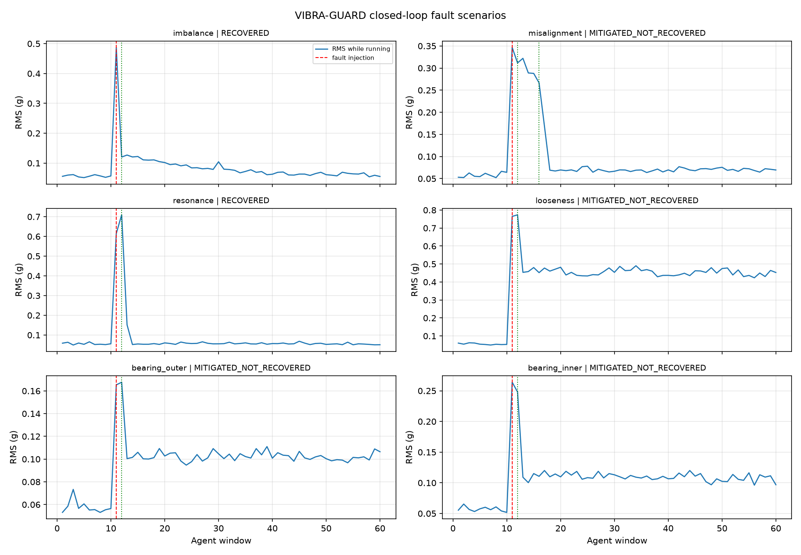
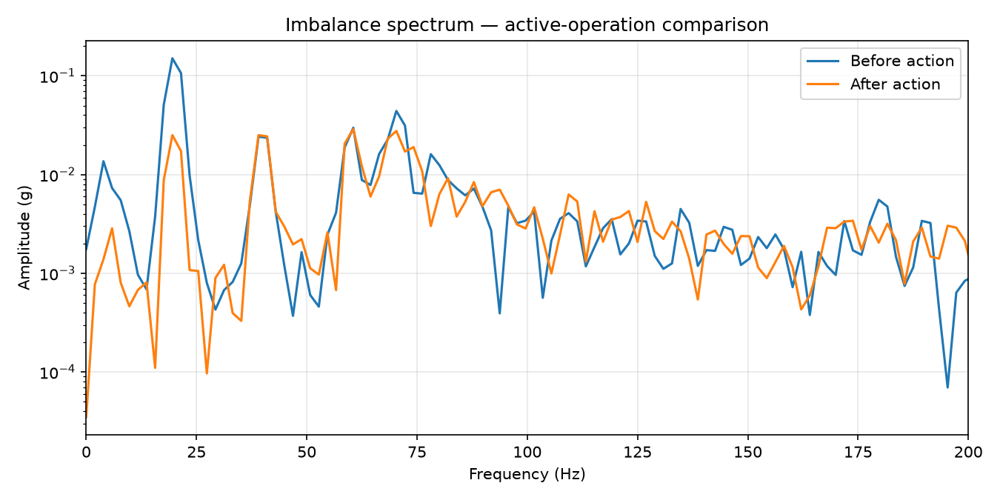

# VIBRA-GUARD
### Intelligent Vibration Detection, Diagnosis and Active Rejection

[](https://github.com/suresh-vlsi/VIBRA-GUARD)
[](https://suresh-vlsi.github.io/VIBRA-GUARD/)
[](https://vibra-guard.streamlit.app/)

**VIBRA-GUARD** is a software-based intelligent vibration monitoring and active rejection system. It combines physics-based vibration simulation, signal processing, anomaly detection, machine learning, fault diagnosis, and adaptive control in a unified workflow.

The project explores how vibration faults can be detected, classified, and mitigated through an intelligent control architecture using simulated IMU measurements.

> **Project status:** VIBRA-GUARD is a simulation-based research prototype. Its current dashboard and validation workflows operate on simulated IMU data. Physical sensor integration and hardware-based validation have not yet been performed.

---

## 1. Project Overview

Mechanical systems can experience unwanted vibration due to imbalance, shaft misalignment, resonance, looseness, and bearing defects. These disturbances can affect system stability, reliability, and operating life.

VIBRA-GUARD implements an intelligent workflow to:

1. Simulate vibration signals under healthy and faulty operating conditions.
2. Process vibration signals and extract relevant features.
3. Detect abnormal vibration behaviour.
4. Identify the probable fault category.
5. Apply adaptive vibration rejection.
6. Evaluate the resulting vibration reduction and recovery status.
7. Visualise system behaviour through an interactive dashboard.

The system combines model-based simulation with data-driven intelligence and feedback-oriented control.

## 2. System Architecture

```text
        Physics-Based Vibration Simulator
                     |
                     v
              Simulated IMU Data
                     |
                     v
              Signal Processing
                     |
                     v
             Feature Extraction
                     |
          +----------+----------+
          |                     |
          v                     v
   Anomaly Detection      Fault Diagnosis
          |                     |
          +----------+----------+
                     |
                     v
             Intelligent Agent
                     |
                     v
          Adaptive Active Control
                     |
                     v
          Closed-Loop Verification
                     |
                     v
           Results and Dashboard
```

### Main processing stages

| Stage | Function |
|---|---|
| Simulation | Generates vibration signals for different operating conditions |
| Signal processing | Analyses vibration characteristics in the frequency and time domains |
| Feature extraction | Extracts information useful for anomaly detection and diagnosis |
| Anomaly detection | Identifies deviations from healthy operating behaviour |
| Fault diagnosis | Classifies the simulated fault condition |
| Intelligent agent | Coordinates detection, diagnosis, and control decisions |
| Active control | Applies harmonic feed-forward FxLMS rejection/adaptation |
| Verification | Evaluates vibration reduction and recovery status |
| Dashboard | Presents system outputs and experiment results |

## 3. Supported Operating Conditions

The simulator considers seven operating classes:

| Operating condition | Description |
|---|---|
| Healthy | Normal operating condition |
| Imbalance | Uneven mass distribution causing periodic vibration |
| Misalignment | Shaft or coupling alignment error |
| Resonance | Excitation near a system natural frequency |
| Looseness | Mechanical looseness producing abnormal vibration |
| Bearing outer-race fault | Simulated outer-race bearing defect |
| Bearing inner-race fault | Simulated inner-race bearing defect |

## 4. Key Features

- Physics-based vibration simulation.
- Simulated IMU signal generation.
- Time-domain and frequency-domain signal analysis.
- Statistical and spectral feature extraction.
- Machine-learning-based fault classification.
- Anomaly detection using a learned healthy baseline.
- Intelligent fault diagnosis and decision-making.
- Harmonic feed-forward FxLMS vibration rejection/adaptation.
- Closed-loop mitigation and recovery evaluation.
- Randomized fault-validation experiments.
- Interactive Streamlit dashboard.
- Visualisation of vibration scenarios and spectrum imbalance.

## 5. Repository Structure

```text
VIBRA-GUARD/
│
├── main.py
├── dashboard.py
├── requirements.txt
├── README.md
├── LICENSE_DECISION.txt
├── .gitignore
│
├── vibeagent/
│   ├── __init__.py
│   ├── agent.py
│   ├── anomaly.py
│   ├── config.py
│   ├── control.py
│   ├── diagnosis.py
│   ├── dsp.py
│   └── simulator.py
│
├── experiments/
│   ├── __init__.py
│   ├── anomaly_visualization.py
│   ├── bearing_analysis.py
│   ├── bearing_comparison.py
│   ├── bearing_snr.py
│   ├── engineering_calculations.py
│   ├── fault_classifier.py
│   ├── feature_learning.py
│   ├── fft_experiment.py
│   ├── generate_outcome1.py
│   ├── generate_outcome1_rms_panel.py
│   ├── generate_outcome2.py
│   ├── mahalanobis_experiment.py
│   ├── robust_fault_classifier.py
│   ├── robust_validation.py
│   ├── robust_validation_v5_1.py
│   ├── simulator_experiment.py
│   └── three_class_visualization.py
│
├── results/
│   ├── scenarios.png
│   ├── spectrum_imbalance.png
│   ├── vibra_guard_outcome1.png
│   ├── vibra_guard_outcome2.png
│   ├── v5_randomized_validation.csv
│   └── v5_1_corrected_validation.csv
│
└── docs/
    ├── index.html
    ├── script.js
    └── styles.css
```

## 6. Installation and Setup

### Requirements

- Python 3.10 or later recommended
- NumPy
- SciPy
- Scikit-learn
- Matplotlib
- Pandas
- Streamlit

### Clone the repository

```bash
git clone https://github.com/suresh-vlsi/VIBRA-GUARD.git
cd VIBRA-GUARD
```

### Create a virtual environment

**Windows PowerShell**

```powershell
python -m venv .venv
.venv\Scripts\Activate.ps1
```

**Ubuntu / WSL**

```bash
python3 -m venv .venv
source .venv/bin/activate
```

### Install dependencies

```bash
pip install -r requirements.txt
```

## 7. Running the Project

### Quick simulation

```bash
python main.py --quick
```

Runs the quick simulation and validation workflow.

### Full simulation

```bash
python main.py
```

Runs the standard project workflow.

### Launch the dashboard

```bash
streamlit run dashboard.py
```

The dashboard provides a visual interface for exploring the simulated vibration-monitoring workflow.

## 8. V4.0.0 Quick Validation Results

The following results were obtained from the V4 quick simulation run.

### Detection and diagnosis

| Metric | Result |
|---|---:|
| Healthy baseline RMS | 0.0597 g |
| Anomaly threshold | 8.8037 |
| Random Forest classification accuracy | 97.9% |
| Anomaly detection F1-score | 0.987 |
| Healthy false-alarm rate | 0.0% |
| Fault recall | 97.5% |
| Fused diagnosis on six fault classes | 100% |

**Evaluation details:**

- Random Forest accuracy was evaluated on 140 unseen simulated samples, with 20 samples per class across seven classes.
- The 100% fused-diagnosis result was obtained across six fault classes using 120 samples. The corresponding confusion matrix did not include healthy test samples; therefore, this result should not be interpreted as overall seven-class accuracy.

### Closed-loop vibration mitigation

The quick run produced the following simulated vibration reductions:

| Fault condition | Vibration reduction | Outcome |
|---|---:|---|
| Imbalance | 13.88 dB | Recovered |
| Misalignment | 12.27 dB | Mitigated, not recovered |
| Resonance | 21.89 dB | Recovered |
| Looseness | 4.76 dB | Mitigated, not recovered |
| Bearing outer-race | 4.37 dB | Mitigated, not recovered |
| Bearing inner-race | 7.54 dB | Mitigated, not recovered |

**Summary:**

- 6 out of 6 fault conditions were diagnosed in this demonstration.
- All 6 conditions showed a measured reduction in vibration.
- 2 conditions achieved recovered status.
- 4 conditions achieved mitigation without verified recovery.
- No safety shutdown occurred during this quick run.

Vibration reduction values represent the measured change reported by the simulation's closed-loop verification procedure. Mitigation does not necessarily imply verified healthy recovery.

## 9. Randomized Validation Experiments

Separate randomized validation datasets are maintained for V5 and V5.1. These experiments should be interpreted independently of the V4 quick-run results.

Both datasets contain 140 simulated trials:

- 120 fault-condition trials.
- 20 healthy-condition trials.

### V5 randomized validation

| Metric | Result |
|---|---:|
| Fault detection | 103/120 (85.8%) |
| Correct diagnosis | 103/120 (85.8%) |
| Verified mitigation | 78/120 (65.0%) |
| Recovery | 37/120 (30.8%) |
| Safety stops | 33/120 (27.5%) |
| Healthy false alarms | 0/20 (0.0%) |

Dataset: `results/v5_randomized_validation.csv`

### V5.1 corrected validation

| Metric | Result |
|---|---:|
| Fault detection | 103/120 (85.8%) |
| Correct diagnosis | 101/120 (84.2%) |
| Verified mitigation | 77/120 (64.2%) |
| Recovery | 36/120 (30.0%) |
| Safety stops | 34/120 (28.3%) |
| Healthy false alarms | 0/20 (0.0%) |

Dataset: `results/v5_1_corrected_validation.csv`

The V5.1 dataset additionally records diagnostic confidence, severity, incident RMS, trip RMS, trip stage, trip state, and stop reason.

**Important:** V5 and V5.1 are separate experimental datasets. Their metrics are not combined, and the V5.1 corrected evaluation should not be interpreted as a change to the V4 implementation.

# V5 randomized validation
python -m experiments.robust_validation --trials 5 --quiet

# V5.1 corrected validation
python -m experiments.robust_validation_v5_1 --trials 5 --quiet

# Larger V5.1 experiment
python -m experiments.robust_validation_v5_1 --trials 20 --quiet

## 10. Results and Visualisations

### Simulated vibration scenarios



### Imbalance frequency spectrum



### Additional outcome visualisations

| Result | File |
|---|---|
| Outcome 1 | `results/vibra_guard_outcome1.png` |
| Outcome 2 | `results/vibra_guard_outcome2.png` |

## 11. Technology Stack

| Technology | Application |
|---|---|
| Python | Core implementation |
| NumPy | Numerical computation |
| SciPy | Signal processing and scientific computation |
| Scikit-learn | Machine learning and classification |
| Matplotlib | Signal and result visualisation |
| Pandas | Experimental data handling |
| Streamlit | Interactive dashboard |
| Git and GitHub | Version control and project hosting |

## 12. Current Limitations

VIBRA-GUARD is currently a software simulation and research prototype.

- The live dashboard currently operates on simulated IMU data.
- Physical IMU sensor integration has not yet been implemented.
- Hardware-based active vibration rejection has not been demonstrated.
- The reported performance metrics are based on simulated experiments.
- Real-world performance under changing mechanical loads, sensor noise, and physical actuator constraints remains to be validated.

Physical sensor integration and hardware-based validation remain future extensions.

## 13. Future Work

Potential extensions include:

1. Integration with physical IMU sensors.
2. Real-time vibration acquisition and monitoring.
3. Hardware-in-the-loop testing.
4. Embedded implementation of signal-processing and control algorithms.
5. Experimental validation of adaptive vibration rejection.
6. Evaluation under real mechanical operating conditions.
7. Improved robustness against sensor noise and changing operating conditions.

## 14. References and Acknowledgements

The project draws on concepts from vibration analysis, digital signal processing, anomaly detection, machine learning, and adaptive control.

Refer to the project presentation and its technical references for the supporting background and methodology. Relevant algorithm and dataset references should be added here as the implementation incorporates specific external methods or public datasets.

## 15. Project Links

| Resource | Link |
|---|---|
| GitHub repository | https://github.com/suresh-vlsi/VIBRA-GUARD |
| Project portfolio | https://suresh-vlsi.github.io/VIBRA-GUARD/ |
| Live Streamlit dashboard | https://vibra-guard.streamlit.app/ |

---

**VIBRA-GUARD — Intelligent Vibration Detection, Diagnosis and Active Rejection**

*An integrated simulation-based exploration of intelligent condition monitoring and adaptive vibration control.*